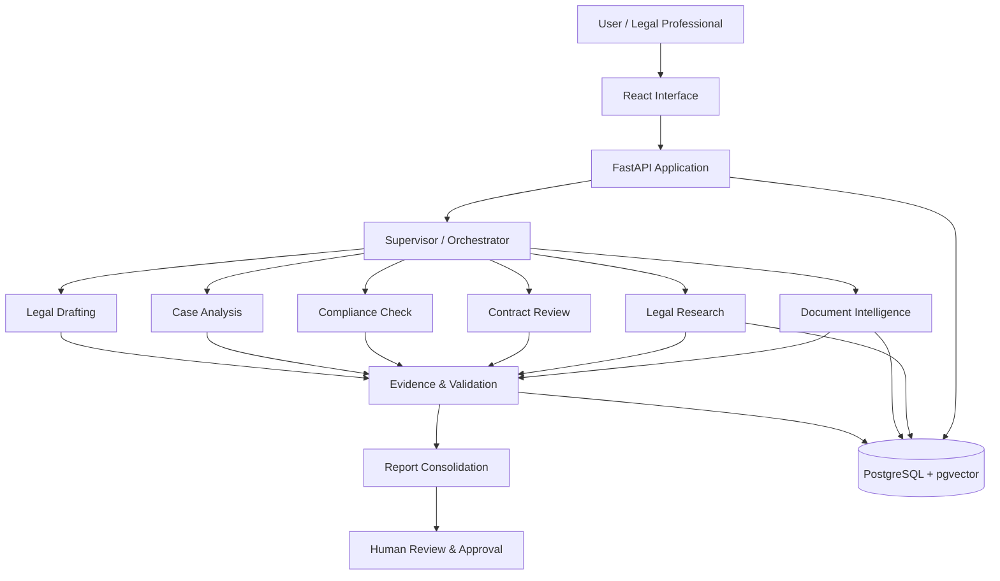
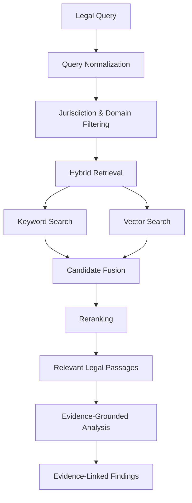

#  Agentic Legal Intelligence Platform (ALIP)

> An agentic AI-powered legal document intelligence system designed to assist legal professionals with contract analysis, grounded legal research, risk identification, evidence validation, and structured report generation.

## Overview

The **Agentic Legal Intelligence Platform (ALIP)** is a human-in-the-loop AI decision-support platform that streamlines legal document review by combining document intelligence, Retrieval-Augmented Generation (RAG), specialized AI components, workflow orchestration, and evidence validation.

Instead of relying on a single LLM to perform every task, ALIP follows a controlled workflow in which a supervisor orchestrates specialized components based on the user's request. Findings are grounded in document excerpts and retrieved legal sources, validated for evidence and citation integrity, and presented for professional review.

The platform aims to reduce the manual effort involved in reviewing lengthy legal documents while improving evidence traceability, structured analysis, and workflow efficiency.

---

## Problem Statement

Legal professionals often spend considerable time:

- Reviewing lengthy contracts and legal documents.
- Identifying clauses, obligations, dates, and potential risks.
- Searching statutes, regulations, and judgments.
- Cross-referencing legal provisions with contractual terms.
- Preparing structured reports and documenting findings.

Traditional workflows are fragmented across multiple tools. General-purpose LLMs can also produce unsupported conclusions or unreliable citations.

ALIP addresses these challenges through a coordinated, evidence-oriented AI workflow that combines document analysis, retrieval, specialized processing, validation, and human oversight.

---

## Key Features

- **Legal Document Processing** – Upload and process PDF and DOCX documents.
- **Clause Extraction** – Identify clauses, obligations, entities, dates, and document references.
- **Agentic Workflow Orchestration** – Route requests to relevant specialized components through conditional workflows.
- **Contract Risk Analysis** – Identify potential contractual risks, ambiguities, missing protections, and deviations.
- **Legal Research with RAG** – Retrieve relevant legal passages from a curated knowledge base.
- **Evidence-Linked Findings** – Associate findings with original document excerpts and retrieved legal sources.
- **Citation Validation** – Check source metadata, citation references, and evidence alignment.
- **Structured Report Generation** – Consolidate findings into reviewable legal analysis reports.
- **Human-in-the-Loop Review** – Allow legal professionals to review, edit, approve, or reject findings.

---

## System Architecture

ALIP follows a modular architecture consisting of a user interface, application layer, orchestration layer, specialized intelligence components, evidence validation, and data storage.

### Architecture Components

| Component | Responsibility |
|---|---|
| User Interface | Document upload, queries, findings, citations, review and approval |
| Application/API | Authentication, document management, workflow requests and report delivery |
| Supervisor / Orchestrator | Task classification, conditional routing, state management and coordination |
| Document Intelligence | Parsing, segmentation and extraction of clauses and entities |
| Legal Research | Retrieval of statutes, regulations, judgments and supporting passages |
| Contract Review | Identification of risks, ambiguities and missing protections |
| Compliance Check | Comparison against specified checklists and sources |
| Case Analysis | Organization of case facts, parties, events and evidence |
| Legal Drafting | Generation of drafts using approved context and sources |
| Evidence & Validation | Citation checks, source verification and completeness checks |
| Storage | Documents, embeddings, findings, citations, workflow state and audit information |

---

## Agentic Workflow

The platform uses a controlled agentic workflow rather than invoking every component for every request.

### Workflow Pipeline

1. **Document Upload** – Upload a legal document and validate its metadata.
2. **Document Processing** – Parse text, tables, page boundaries and document structure.
3. **Information Extraction** – Extract clauses, entities, obligations, dates and relevant terms.
4. **Request Classification** – Determine the type of legal task requested.
5. **Conditional Routing** – Route the request to relevant specialized components.
6. **Parallel Execution** – Execute independent tasks concurrently when applicable.
7. **Legal Retrieval** – Retrieve relevant legal material from the configured knowledge base.
8. **Evidence-Based Analysis** – Generate findings using document excerpts and retrieved evidence.
9. **Validation** – Check citations, references, source metadata and report completeness.
10. **Report Consolidation** – Consolidate validated findings into a structured report.
11. **Human Review** – Allow a legal professional to review, modify, approve or reject the findings.

### Example

A legal professional uploads a rental agreement and requests an analysis of:

- Termination conditions
- Security deposit provisions
- Tenant obligations

The system extracts relevant clauses, identifies potentially problematic provisions, retrieves relevant legal material from the configured knowledge base, and prepares evidence-linked findings.

The resulting report highlights potential issues for review rather than presenting automated findings as definitive legal conclusions.

---

## Specialized Intelligence Components

| Component | Function | Expected Output |
|---|---|---|
| Document Intelligence | Parsing, segmentation and information extraction | Clauses, entities, dates, obligations and page references |
| Legal Research | Retrieval of legal authorities and passages | Ranked evidence with source metadata |
| Contract Review | Risk identification and contract analysis | Evidence-linked risk findings |
| Compliance Check | Checklist-based verification | Checklist results and unresolved items |
| Case Analysis | Structured analysis of case information | Case summaries and timelines |
| Legal Drafting | Context-grounded drafting | Reviewable legal drafts |
| Review & Validation | Evidence checks and report completeness | Validation flags and review-ready reports |

---

## Retrieval-Augmented Generation (RAG)

The platform uses a curated legal knowledge base to support evidence-grounded legal research.

### Retrieval Pipeline

### Retrieval Strategy

The retrieval pipeline combines:

- **Keyword Search** – Captures exact legal terminology, provision numbers and specific phrases.
- **Vector Search** – Retrieves semantically relevant passages.
- **Metadata Filtering** – Restricts retrieval based on jurisdiction, legal domain, source type and other metadata.
- **Reranking** – Prioritizes retrieved passages when reranking is available.

### Legal Source Metadata

Retrieved documents may include:

- Jurisdiction
- Legal domain
- Source type
- Issuing authority
- Court and judgment date
- Provision or section number
- Publication and effective dates
- Source URL
- Amendment or version status
- Ingestion timestamp

Retrieved passages are used as evidence context for analysis and linked to generated findings.

---

## Technology Stack

| Technology | Purpose |
|---|---|
| React | Frontend user interface |
| Python | AI and document-processing logic |
| FastAPI | Backend API |
| LangGraph | Stateful and conditional workflow orchestration |
| LLMs | Document understanding, reasoning and generation |
| RAG | Grounded legal research |
| Hybrid Search | Keyword and semantic retrieval |
| PostgreSQL | Structured data storage |
| pgvector | Vector embeddings and similarity search |
| PyMuPDF | PDF processing |
| python-docx | DOCX processing |
| OCR | Fallback processing for scanned documents |
| Docker | Containerization and deployment |

---

## Evaluation

The system is evaluated across extraction quality, retrieval performance, risk detection, citation integrity, orchestration accuracy, workflow reliability and efficiency.

### Evaluation Metrics

| Metric | Value |
|---|---:|
| Clause Extraction Precision | 92.4% |
| Clause Extraction Recall | 89.1% |
| Risk Finding Precision | 82.0% |
| Risk Finding Recall | 76.0% |
| Citation Validity Rate | 95.0% |
| Citation Support Rate | 79.0% |
| Workflow Completion Rate | 92.0% |
| Median End-to-End Latency | 42 seconds |
| 95th Percentile Latency | 96 seconds |
| Human Acceptance / Minor-Edit Rate | 71.0% |

> These metrics reflect the evaluation results documented for the project. Their interpretation depends on the evaluation dataset, annotation methodology and testing conditions.

### Evaluation Dimensions

- Extraction precision and recall
- Entity extraction performance
- Retrieval quality and evidence coverage
- Risk identification accuracy
- Citation validity and citation support
- Workflow routing accuracy
- Workflow completion rate
- End-to-end latency
- Human acceptance and editing requirements

---

## Baseline Comparison

The system is designed to be evaluated against simpler approaches.

| System | Description |
|---|---|
| Baseline A | Single LLM without retrieval |
| Baseline B | Single LLM with RAG |
| Proposed System | Supervisor orchestration, specialized components, RAG and evidence validation |

### Planned / Relevant Experiments

- Baseline comparison between single-LLM and orchestrated workflows.
- Validation ablation to assess the impact of citation and evidence validation.
- Orchestration ablation to compare conditional routing with invoking all components.
- Retrieval experiments to evaluate hybrid retrieval and reranking.
- Complexity analysis involving long, scanned and table-heavy documents.

---

## Security & Responsible AI

ALIP is designed with responsible AI principles and professional oversight in mind.

- Role-based access control.
- Matter-level document isolation.
- Secure API key and secret management.
- Encryption in transit and appropriate protection at rest.
- Uploaded documents treated as untrusted input.
- Restricted tool access and argument validation.
- Human approval before consequential use.
- Reporting of uncertainty and insufficient evidence.
- Audit trails for important system and human actions.
- Respect for source access terms and privacy obligations.

---

## Limitations

- Legal coverage is limited to the configured jurisdiction and curated corpus.
- Retrieval may miss relevant legal authorities.
- Retrieved sources may not be applicable to the specific legal context.
- LLMs may misinterpret complex clauses, exceptions or interactions.
- Citation validation does not guarantee legal interpretation correctness.
- OCR and parsing errors may affect downstream analysis.
- Risk classifications depend on the evaluation rubric.
- Performance may vary across document formats, languages and complexity.
- The platform is not a substitute for professional legal advice.

---

## Future Work

- Expand jurisdiction and legal-domain coverage.
- Implement amendment-aware and effective-date-aware retrieval.
- Improve cross-document comparison.
- Develop contradiction detection.
- Explore legal knowledge graphs.
- Expand expert-annotated evaluation datasets.
- Improve privacy-preserving deployment.
- Explore local LLM deployments.
- Monitor source freshness and model performance.
- Support multilingual legal document processing.

---

## Disclaimer

This platform is intended for research and decision-support purposes. It does not provide definitive legal advice, replace legal professionals, or guarantee the accuracy, completeness or applicability of legal information. All consequential legal decisions should be reviewed by qualified professionals.

